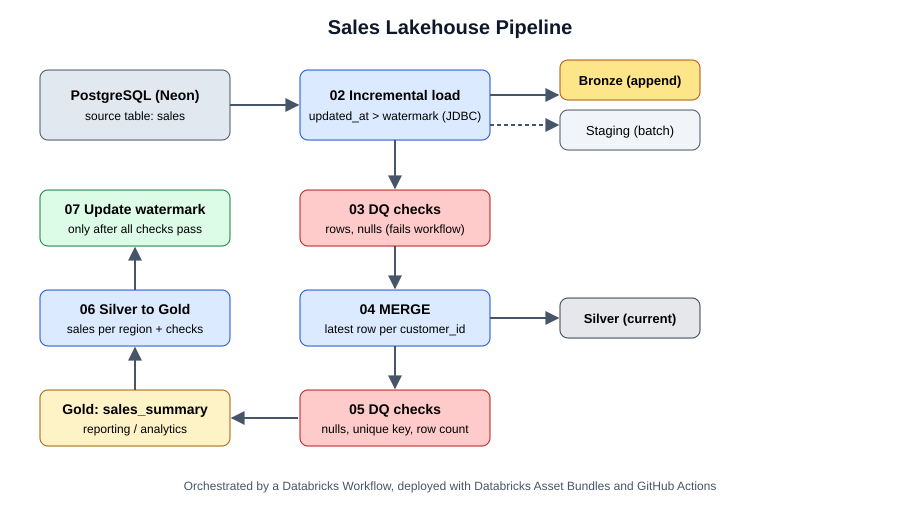

# Sales Lakehouse Pipeline

An incremental ETL pipeline on Databricks using the Medallion architecture (Bronze, Silver, Gold). Changed rows are pulled from a PostgreSQL source with a watermark, cleaned into a current-state Silver table, and aggregated into a Gold table. Data-quality gates sit between the layers and fail the workflow when a check breaches. Deployment is automated with Databricks Asset Bundles and GitHub Actions.

**Author:** Dhanush

## Architecture

```text
PostgreSQL (source: sales)
        │  JDBC, rows where updated_at > watermark
        ▼
02 incremental load ──► Bronze  (append-only history)  + staging batch
        │
        ▼
03 DQ checks (batch not null, bronze not empty)        ◄── fails the workflow on breach
        │
        ▼
04 MERGE ──► Silver (latest row per customer_id)
        │
        ▼
05 DQ checks (no nulls, unique key, no lost customers) ◄── fails the workflow on breach
        │
        ▼
06 Gold: sales_summary (total sales per region) + checks
        │
        ▼
07 update watermark (only reached after every check passed)
```



## Layers

| Layer | Table | Behaviour |
|-------|-------|-----------|
| Bronze | `bronze.sales` | Raw rows, append-only, every version kept with `ingestion_time` |
| Staging | `staging.sales_incremental` | The current batch only (overwritten each run) |
| Silver | `silver.sales` | One row per `customer_id`, updated with MERGE |
| Gold | `gold.sales_summary` | `SUM(amount)` per `region` |
| Metadata | `metadata.pipeline_metadata` | Last processed `updated_at` per pipeline |

Example: Bronze keeps `customer_id = 2` with amounts 200, 999 and 1200; Silver keeps only 1200.

## Data-quality checks

Implemented in `src/sales_lakehouse_pipeline/quality.py` and unit-tested in `tests/`.

| Gate | Checks |
|------|--------|
| After load (`03_dq_bronze_checks`) | Bronze not empty; no nulls in `customer_id`, `updated_at` of the staged batch |
| After MERGE (`05_dq_silver_checks`) | Silver not empty; no nulls in `customer_id`, `amount`, `updated_at`; `customer_id` unique; Silver has at least as many rows as distinct Bronze customers |
| After Gold (`06_silver_to_gold`) | Gold not empty; one row per `region` |

A failed check raises `DataQualityError`, the task fails, and all downstream tasks (including the watermark update) are skipped.


## Project structure

```text
sales-lakehouse-pipeline/
├── databricks.yml                 # bundle definition (dev / prod targets)
├── resources/sales_pipeline.job.yml
├── src/
│   ├── 00_setup.ipynb             # run once: schemas, tables, watermark seed
│   ├── 01_initial_load.ipynb      # run once: full load
│   ├── 02_incremental_load.ipynb … 07_update_metadata.ipynb   # the scheduled workflow
│   └── sales_lakehouse_pipeline/quality.py
├── tests/                         # local pytest suite (PySpark, no workspace needed)
└── .github/workflows/             # ci.yml (lint + tests), deploy.yml (validate + deploy)
```

## Setup

1. **Secrets.** Credentials are never stored in the repo. Create a secret scope named `sales_pipeline` with the keys `pg_host`, `pg_database`, `pg_user`, `pg_password`:
   ```bash
   databricks secrets create-scope sales_pipeline
   databricks secrets put-secret sales_pipeline pg_host
   databricks secrets put-secret sales_pipeline pg_database
   databricks secrets put-secret sales_pipeline pg_user
   databricks secrets put-secret sales_pipeline pg_password
   ```
2. **Source table.** PostgreSQL table `sales(customer_id, amount, region, updated_at)`.
3. **Deploy.** `export DATABRICKS_HOST=https://<your-workspace>` then `databricks bundle deploy --target dev`.
4. **Initialise.** Run `00_setup` then `01_initial_load` once in the workspace.
5. **Run.** `databricks bundle run sales_pipeline_job`.

## Tests

```bash
pip install pyspark==3.5.3 pytest ruff
ruff check src tests
python -m pytest -q
```

## CI/CD

`ci.yml` lints and runs the unit tests on every pull request and push. `deploy.yml` runs the same tests on `main`, then validates and deploys the bundle to the `prod` target. Repository secrets required: `DATABRICKS_HOST`, `DATABRICKS_TOKEN`.

## Tech stack

Azure Databricks, Delta Lake, Databricks Workflows, Databricks Asset Bundles, PySpark, SQL, PostgreSQL, GitHub Actions, pytest, ruff.
